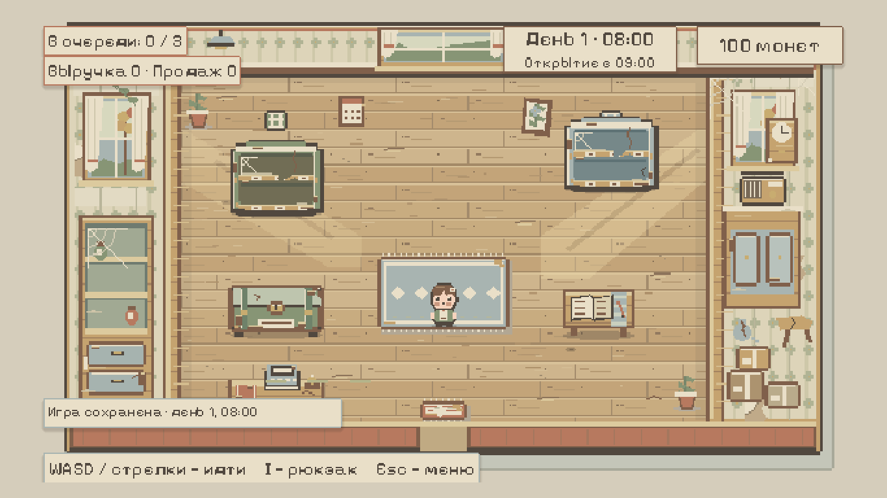
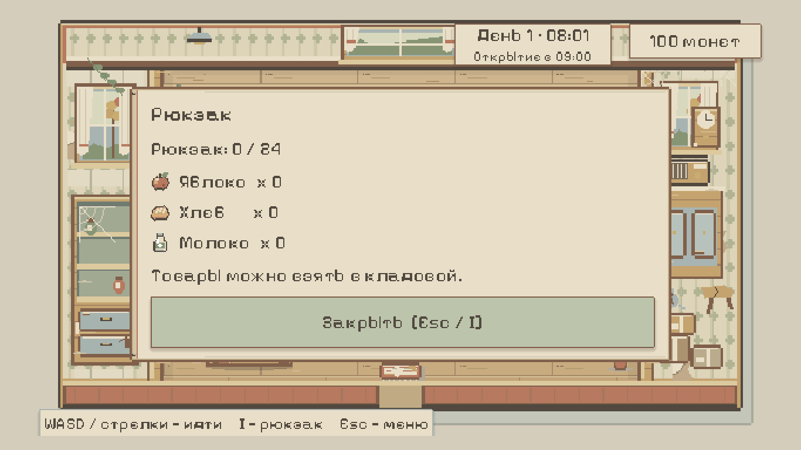
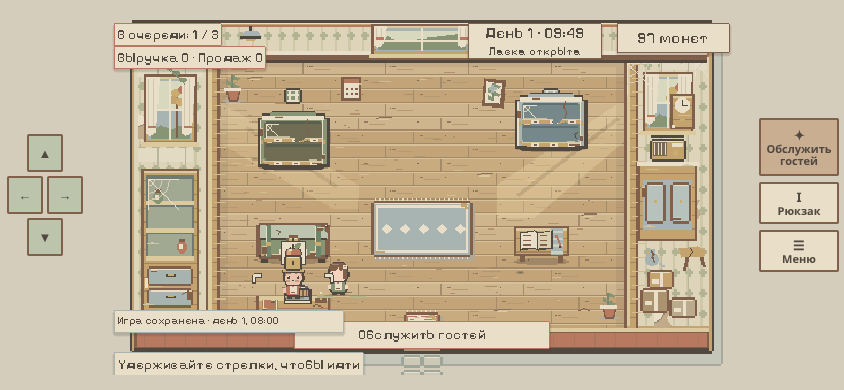
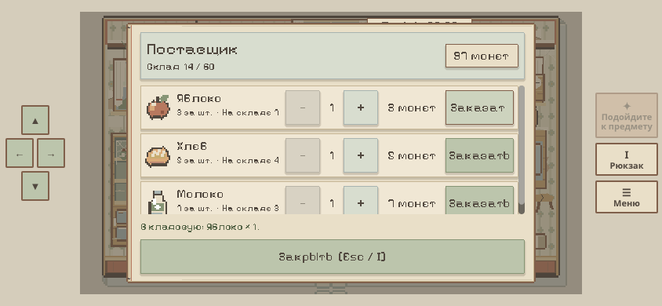
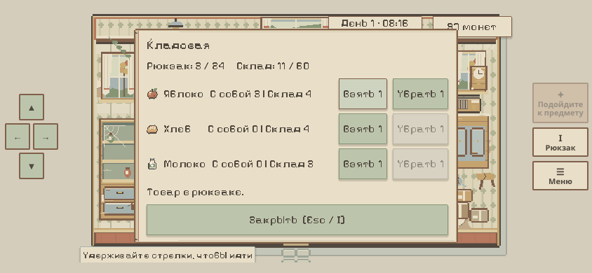
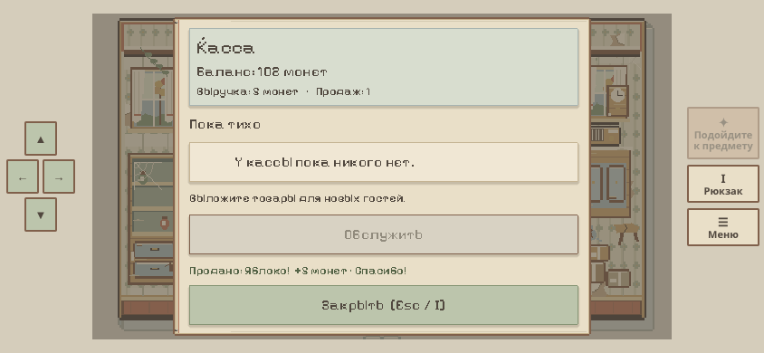
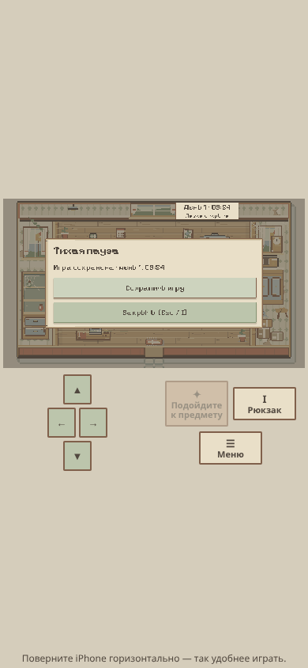

# Уютная осенняя лавка: художественная доработка

База: `feat/pastel-retro-shop`, PR #10, коммит
`66e55d5d25688e4f2eac673a85b3e18668b286e6`.
Отдельная ветка: `feat/autumn-vintage-shop`.

## Художественное направление

Лавка европейской деревни с деталями японских ретро-магазинчиков 1960–1970-х:
тёплый дощатый пол, старая крашеная мебель, касса, радио и записная книга заказов.
Помещение давно не ремонтировали, но проходы свободны и торговое оборудование
пригодно для работы. Кремовая бумага и мягкий солнечный свет сохраняют уют.

Опорная палитра: `#E9DFC8`, `#C5A36F`, `#879575`, `#80604B`, `#B7795F`, `#A8B4B1`.
Розовые обои, сиреневые покрытия и конфетные кнопки заменены приглушёнными цветами.
Серо-голубая витрина, ковёр и тумба у радио, оливковая витрина и сундук,
терракотовая отделка и осенняя листва дают разные цветовые пятна.

- Выцветшие полосатые обои: швы, выбеленные участки, рваные края и отслоения со
  светлыми загибами, видимая штукатурка.
- Истёртый пол: разный тон досок, царапины, щели, сучки, гвозди и светлые потёртости.
- Старая мебель: сколы краски до дерева, треснувшая боковина, выщербленная кромка
  полки, пыль, паутина и старые ценники. На пустых полках нет нарисованных товаров.
- Боковые ниши: старые коробки, сломанный табурет, треснувший кувшин и отбитая ручка,
  старые часы. Всё находится вне игрового прохода.
- Свет: полупрозрачные ступенчатые солнечные пятна из боковых окон, тени переплётов,
  мягкие пиксельные тени вдоль стен и под мебелью. Свет запечён в спрайты.
- Интерфейс: кремовые страницы, поле у переплёта, тёмные чернила, пиксельные стежки,
  тонкие рамки, серо-голубые и оливковые состояния кнопок. Мобильная оболочка тоже
  использует новую палитру.

Чиби-силуэты, 48 поз персонажей, крупные пиксели, nearest-фильтрация, перспектива,
камера 1,15× и размеры сенсорных кнопок сохранены. Экономика, маршруты, коллизии,
сигналы, цены, вместимость, время и формат сохранения не менялись. Ремонт и другие
новые механики не добавлены. PR не включает слияние или публикацию сайта.

Исходник графики: [build_shop_art.py](../tools/build_shop_art.py).
PNG воспроизводятся через `python3 tools/build_shop_art.py` (Pillow, seed 81).
Шрифт и его OFL-лицензия сохранены: [описание ресурсов](../assets/README.md).

## Проверка

Проверено 24 ноября 2026 года официальным **Godot 4.3.stable.77dcf97d8**.

- `bash tests/run_checks.sh`: **545 проверок, 0 ошибок** — инвентарь и взаимодействия
  (189), покупатели (61), касса (72), дни (80), сохранения (127), шрифт и интерфейс (16).
  Импорт редактора и smoke-запуск стартовой сцены также прошли.
- `godot --headless --path . --export-release Web builds/web/index.html`: настоящий
  однопоточный release Web export, `.wasm` и `.pck` созданы без ошибок движка.
- Playwright 1.62.1, Chromium и Linux WebKit: сенсорные кнопки и меню, ручное
  сохранение в IndexedDB, перезагрузка и «Продолжить», поворот и границы canvas /
  кнопок при 844×390, 390×844, 667×375 и 844×300.
- Полный сценарий Chromium и Linux WebKit: закупка яблока **100 → 97**, перенос трёх яблок
  в рюкзак, выкладка одного, покупатель, продажа **97 → 102**, ручное сохранение
  и восстановление с двумя яблоками в рюкзаке. Обычные нажатия и чтение IndexedDB,
  без отладочных игровых API.
- Повторная генерация графики: SHA-256 всех PNG совпали. `git diff --check` чистый.

Linux WebKit и эмуляция touch не заменяют физический iPhone; iOS Safari на устройстве
здесь не проверялся. Для WebKit в этой среде недостающие библиотеки распакованы в
каталог задачи; системные библиотеки не менялись. Обёртка запуска сохраняет путь
к ним (стандартная обёртка Playwright заменяет `LD_LIBRARY_PATH`).

## Реальные скриншоты

Сняты с работающего release Web export через Playwright, без дорисовки, изменения
игрового состояния или монтажа. ПК: 1366×768, canvas 1280×720 (2×). Телефон: 844×390,
touch, DPR 3, PNG в CSS-размере. Дополнительно показан интерфейс при 390×844.
Снимки мобильной торговли используют реальные товары, посетителей и баланс.









## Воспроизведение

Godot 4.3 и официальные шаблоны Web export; Pillow нужен только для генератора:

```sh
python3 tools/build_shop_art.py
bash tests/run_checks.sh
mkdir -p builds/web
godot --headless --path . --export-release Web builds/web/index.html
python3 -m http.server 8060 --bind 127.0.0.1 --directory builds/web
```

В другом терминале:

```sh
cd web
npm ci
npx playwright install --with-deps chromium webkit
npm test
npm run test:gameplay
REVIEW_PREFIX=vintage npm run capture:review
```

`GAME_URL`, `BROWSERS`, `CHROMIUM_PATH` и `WEBKIT_PATH` поддерживаются существующими
проверками. `REVIEW_PREFIX=vintage` сохраняет новые снимки в `docs/vintage-*.png`,
оставляя исторические `pastel-*.png` из PR #10. При ошибке сценарий пишет кадр
в `builds/review`, не подменяя им финальные скриншоты в документации.
