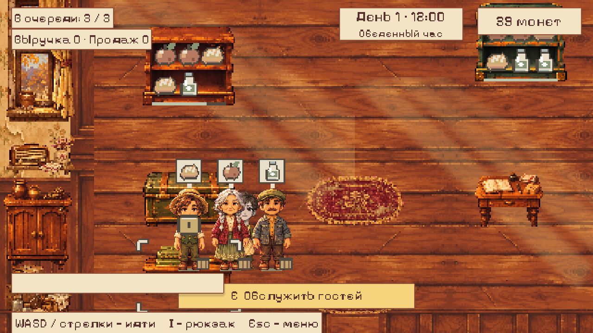

# Масштаб и следящая камера — PR #17

Продолжение ветки `art/illustrated-characters` после `f5ded50`.
Итоговый zoom магазина — **1.6**. Размеры героя и NPC остаются **40×60**.

## Сравнение настоящих кадров

Godot 4.3 stable, OpenGL Compatibility / Mesa llvmpipe, окно 1280×720,
один магазин и одинаковое состояние внутри каждой серии. PNG сохранены прямо
из viewport, без обрезки, изменения размера или перерисовки. Камера 1.15 воспроизводит
прежний неподвижный центр (320,180); варианты 1.6 и 1.8 используют новую камеру.
В серии очереди покупатели пришли обычными маршрутами (seed 8), затем состояние
заморожено на время сравнения. Позиция героя у кассы — (246,260).

| Zoom | Начало игры | Полки и очередь | Оценка |
| --- | --- | --- | --- |
| 1.15 | [Кадр](camera-spawn-1-15.png) | [Кадр](camera-queue-1-15.png) | Широкий обзор и поля вне стен; внешность теряется в помещении. |
| **1.6** | [Кадр](camera-spawn-1-6.png) | [Кадр](camera-queue-1-6.png) | Хорошо видны лица, одежда, товары и фактура мебели; остаются ориентиры и проходы. |
| 1.8 | [Кадр](camera-spawn-1-8.png) | [Кадр](camera-queue-1-8.png) | Детали ещё крупнее, но верхние полки сильнее перекрывает HUD, боковой обзор теснее. |

На 1.6 видимая область — **400×225** игровых единиц вместо примерно 557×313
на 1.15: персонажи выглядят на **39% крупнее на экране**, площадь обзора уменьшается
примерно на 48%. Помещение воспринимается компактнее; целиком видеть его не требуется.



Мобильная Web release, WebKit / профиль iPhone 13: [альбомная ориентация
750×342](camera-mobile.png), [портретная 390×844](camera-mobile-portrait.png),
[рюкзак в портретной ориентации](camera-mobile-inventory.png).
Игровой viewport остаётся 640×360; в портретной ориентации сохранена прежняя
компоновка с кнопками под игрой. Все эти кадры также сохранены без обработки.

## Поведение и повторное использование

`scripts/follow_camera.gd` — самостоятельный `Camera2D` с экспортируемыми `target`,
`world_bounds`, `target_offset`, `follow_speed` и стандартным `zoom`.
Для другой локации достаточно добавить Camera2D с этим скриптом, назначить героя,
прямоугольник нарисованного мира и нужное приближение. `snap_to_target()` предназначен
для появления героя или телепортации. Границы могут иметь отрицательное начало;
локация меньше viewport центрируется по соответствующей оси.

В магазине границы рисунка — **(80,16)–(560,312)**, а не границы коллизии пола.
Полуразмер видимой области учитывает viewport и zoom. Камера останавливается до
границ изображения; округление направлено внутрь, чтобы не открыть полоску пустоты.

Слежение работает после перемещения героя в том же физическом такте. Экспоненциальное
сглаживание со скоростью 12/с имеет постоянную времени около 83 мс (типичное отставание
при ходьбе около 8 игровых единиц). Смещение цели (0,−24) учитывает высоту рисунка
над точкой стоп. Дробный накопитель сглаживания сохраняется, а итоговый сдвиг камеры
округляется до пикселя рендера. Это предотвращает зависание на округлении и дрожание
в покое. Сохранены nearest-фильтрация, существующая привязка 2D к пикселям и целочисленный
масштаб веб-canvas. Дробный zoom означает неодинаковую ширину некоторых исходных
пикселей, но без линейного размытия.

HUD и модальные меню остаются в CanvasLayer; сенсорные кнопки — в DOM вне canvas.
Камера не меняет их размер и координаты. Радиус взаимодействия, поиск доступного
предмета и физическое движение остаются в прежних мировых координатах.
Веб-оболочка, viewport/клавиатура iOS, интерьер, мебель, коллизии, маршруты NPC,
экономика, сохранения и поезд не менялись.

## Воспроизведение

```sh
bash tests/run_checks.sh
godot --path . --audio-driver Dummy --fixed-fps 60 --script res://tools/capture_camera.gd
mkdir -p builds/web
godot --headless --path . --export-release Web builds/web/index.html
python3 tools/package_release.py builds/web "$(git rev-parse HEAD)" --ref refs/heads/art/illustrated-characters
python3 -m http.server 8060 --bind 127.0.0.1 --directory builds/web
# В другом терминале:
cd web
npm ci
npm test
BROWSERS=chromium node smoke.cjs --gameplay
CAPTURE_PREFIX=camera node capture-shop-art.cjs
```

Для съёмки Godot нужен графический дисплей; на Linux без дисплея подходит `xvfb-run -a`.
Инструмент съёмки исключён из экспорта, игровой save-слот не открывает.

## Проверка

- **3924 проверки Godot — 0 failures**, включая 2768 проверок новой камеры:
  реальная ходьба по периметру и проходам, ограничения, отсутствие скачков,
  остановка без дрожания, пиксельная сетка, неподвижный HUD и координаты меню,
  другая большая локация и маленькое помещение.
- Web release Godot 4.3 успешно экспортирован; SHA-256 всех упакованных файлов
  совпадают с манифестом. Художественные ресурсы не изменялись.
- Chromium: smoke и полный `--gameplay` через реальные сенсорные действия.
  Закупка, склад, выкладка на полку, продажа, ручное сохранение и Continue прошли;
  итоговый баланс 102, два яблока в рюкзаке. Пиксельный наблюдатель маршрута теперь
  определяет смещение камеры по ковру, затем находит героя в мировых координатах;
  доступа к игровому состоянию и отладочных хуков не добавлено.
- `BROWSERS=webkit npm test` — весь набор прошёл: сенсорные кнопки, меню,
  сохранение/Continue, повороты экрана, редактор внешности, полная поездка с
  возобновлением, обновление кешированной версии, iOS keyboard/viewport/rotation.
  Chromium smoke также прошёл. iOS-проверка подтверждает сохранение пользовательского
  zoom, фокус поля только по действию пользователя, размеры нативного поля/IME,
  safe area, восстановление canvas после моделируемого перекрытия клавиатурой и поворот.
- Предупреждения ObjectDB при завершении тестов сохранений/персонажей присутствуют
  в прежнем наборе; ошибок скриптов и импорта нет.

Физический iPhone недоступен. Профиль iPhone в Chromium/WebKit проверяет веб-отрисовку
и управление; аппаратный GPU, системная клавиатура и панели Safari полностью не эмулируются.
