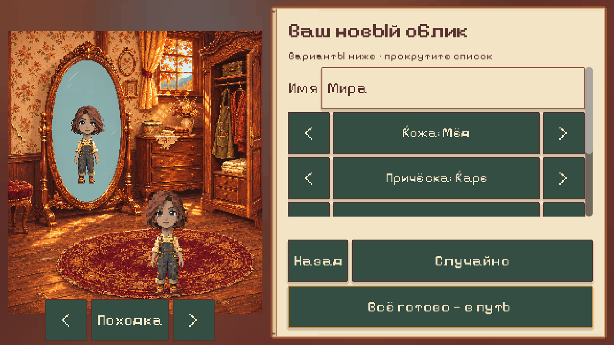
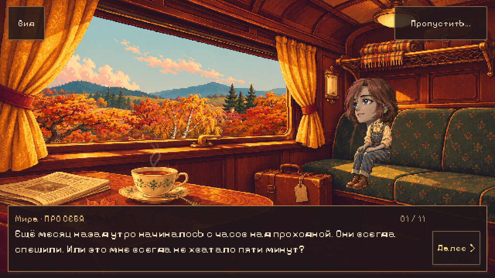
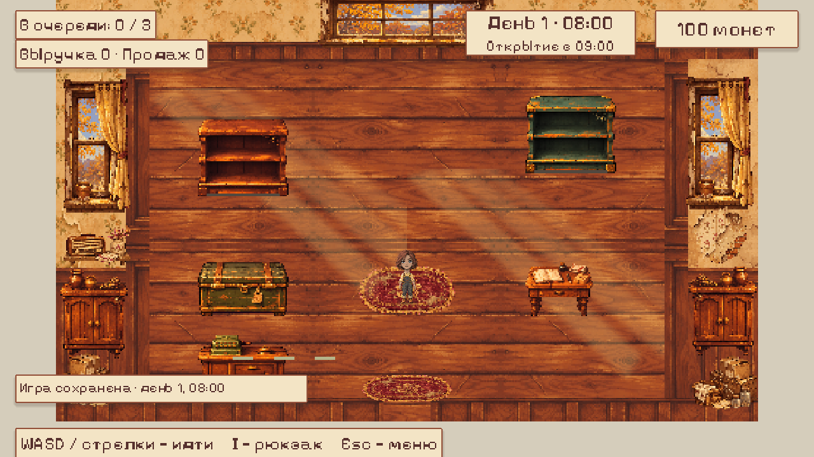

# Персонажи, покупатели и новая гардеробная

Ветка `art/illustrated-characters` создана от актуальной main `751a813`, после
слияния интерьера PR #16. Прочитаны `GAME_DESIGN.md` и `train-art-direction.md`.
Основной ориентир — герой сюжетного поезда: человеческое лицо и красивые глаза,
большая голова, небольшое тело, естественные волосы, объёмная одежда и тёплые
винтажные материалы. Игровая детализация умеренная и читаемая при движении.

## Оригинальные материалы

Шесть новых растровых мастеров в `art/characters/` созданы для проекта с помощью
image generation. Существующие ресурсы поезда использованы как художественный
ориентир, их файлы не менялись. Два листа голов содержат все восемь причёсок,
два листа одежды — все шесть прежних нарядов. Каждый вариант имеет фронтальный,
задний и левый вид; правый зеркальный. Ещё два мастера — покупатели и гардеробная.
Сторонних наборов персонажей нет. Мастера исключены из Godot через `.gdignore`.

`tools/prepare_character_art.py` выделяет кожу, волосы, радужки, постоянные
черты лица, одежду и руки. Технические cyan/lime/red материалы становятся
нейтральными серыми слоями и окрашиваются прежними палитрами внешности.
Головы привязаны по основанию шеи; одежда — по шее и подошвам. ID причёсок,
одежды, кожи, цветов волос и глаз, имя и формат сохранения не менялись.
Все 48 сочетаний причёски/наряда продолжают проходить существующий round-trip
сохранения, вместе с остальными параметрами.

Размер ячейки 64×96. Первоначальный размер в мире 28×42 скорректирован до 40×60
([сравнение до/после](character-scale-review.md)). Опора подошв осталась около прежних
9 пикселей ниже позиции физического тела. Капсула 5×13, скорость, взаимодействия,
пути покупателей, очередь и планировка магазина сохранены. Значки товаров
подняты над новой высотой голов; сами товары и содержимое корзин не менялись.
Слой отрисовки актёров поднят над мебелью: высокое лицо больше не пропадает
под передним краем полки при подходе. Физические формы и точки взаимодействий
при этом остаются прежними.

## Движение и мобильные ресурсы

Шесть разных фаз ходьбы подготовлены офлайн из живописных исходников с локальными
растровыми деформациями: ноги меняют ведущую сторону и приподнимают стопу, руки
движутся навстречу, корпус и голова слегка покачиваются. Одинаковое поле деформации
сохраняет совмещение кожи рук и рукавов. Кончики длинных волос слегка запаздывают.
Покой использует тихое дыхание и короткое моргание. Существующая настройка
отключения анимаций применяется через предка сцены и фиксирует нейтральный вид.
Часы анимации не записываются в сохранение и не участвуют в игровой логике.

Для четырёх направлений одежда и руки имеют восемь поз: нейтральная, нейтральная
при моргании и шесть ходовых. Головы/лицо/радужки содержат только два состояния
на направление, волосы — три. Покачивание общих голов согласуется с готовым
шагом через один трансформ. Это сокращает расчётный объём атласов с 37,5 до
**18,3 MiB RGBA** до расходов драйвера, без потери исходного разрешения лица.
Максимальная ширина текстуры — 2048, nearest, без mipmaps. Новых шейдеров,
частиц, симуляции ткани или кадровой генерации пикселей нет.

Покупатели используют отдельные переиспользуемые головы и одежду: молодой
покупатель в соломенной шляпе, пожилая покупательница с седыми косами и покупатель
среднего возраста в кепке. Существующие три варианта и последовательность
посещений сохранены; личности, имена и отношения не добавлены.

## Гардеробная и соответствие внешности

Новая комната содержит резное деревянное зеркало, шкаф с тканью и одеждой,
комод, сухие цветы, золотые занавески и солнечный ковёр. Стекло в исходнике пустое:
отражение полностью динамическое и использует тот же `CharacterArt`, тот же
словарь внешности и ту же фазу, что герой на ковре. Мобильный герой располагается
выше сенсорных кнопок поворота. Размеры полей, фокус имени, клавиатурное поведение
и обработка iOS viewport не менялись; обновлены только рисунок, размещение
предпросмотра и палитра. Случайный выбор и ходьба/поворот доступны как прежде.

## Реальные кадры

Кадры ПК сняты настоящим Godot 4.3/OpenGL через
`tools/capture_character_art.gd`, без дорисовки и композитинга. Инструмент
использует отдельный временный слот, штатное подтверждение редактора, поезд,
его пропуск, обычные закупки/переносы и естественные посещения покупателей.
В тройке сравнения выбрана Мира: кожа «Мёд» (2), каре (1), медные волосы (5),
голубые глаза (2), комбинезон (2). До и после переходов проверено равенство
внешности редактора, train/view, игрока и сохранённого character.

| Редактор | Поезд | Магазин |
| --- | --- | --- |
|  |  |  |

Мобильные кадры редактора сняты существующим `web/frontend.cjs` в WebKit через
обычные касания, ввод имени, случайный выбор, поворот и прокрутку. Их персонаж
может отличаться от Миры: это отдельная новая игра браузерной проверки.
Кадр активного магазина — отдельная обычная новая игра в WebKit 844×390,
подтверждение героя и штатный пропуск поезда, без подмены состояния.

- [Новый редактор](character-art-editor-default.png)
- [Косички, светлые волосы, тёмная кожа, сарафан](character-art-variant-1.png)
- [Чёлка набок и рубашка с платком](character-art-variant-2.png)
- [Хвост и кардиган](character-art-variant-3.png)
- [Мира в редакторе](character-art-same-hero-editor.png)
- [Мира в неизменённой сцене поезда](character-art-same-hero-train.png)
- [Мира в неизменённом интерьере магазина](character-art-same-hero-shop.png)
- [Магазин с тремя обновлёнными покупателями](character-art-buyers.png)
- [Мобильный редактор WebKit](character-art-mobile-editor.png)
- [Прокрутка до выбора наряда](character-art-mobile-outfits.png)
- [Активный магазин в мобильном WebKit](character-art-mobile-shop.png)

## Воспроизведение

```sh
python3 tools/prepare_character_art.py
GODOT_BIN=/path/to/godot-4.3 bash tests/run_checks.sh
godot --path . --audio-driver Dummy --script res://tools/capture_character_art.gd
godot --headless --path . --export-release Web builds/web/index.html
python3 tools/package_release.py builds/web "$(git rev-parse HEAD)" --ref refs/heads/art/illustrated-characters
```

В отдельном терминале запустите `python3 -m http.server 8060 --directory builds/web`,
затем `cd web && npm test`. Дополнительный торговый сценарий:
`BROWSERS=chromium npm run test:gameplay`.

Физический iPhone недоступен. Chromium/WebKit с профилем iPhone проверяют
настоящий экспорт, сенсорные события, поля, поворот и данные IndexedDB, но
не воспроизводят полностью аппаратный GPU, панели Safari, системную клавиатуру
и реальное автоматическое увеличение iOS. Производительность на устройстве
требует отдельной ручной оценки.

Godot: **1154 проверки, 0 failures**, в том числе 489 проверок персонажа:
все 48 разных пар причёска/наряд в сохранениях, старые версии, неудачная запись,
реальные варианты во всех направлениях, нейтральные цветовые материалы,
шесть разных ходовых кадров каждого наряда/NPC, цикл, моргание, reduced motion,
привязка стоп и редактор. Прежнее предупреждение ObjectDB при выходе теста
персонажей иногда остаётся; SCRIPT ERROR/ERROR и проваленных проверок нет.

Полный `npm test` прошёл в Chromium/WebKit: запуск, сенсорные действия,
редактор/случайный выбор, сохранение всех параметров и их отрисовки после
Continue, полная поездка с возобновлением и переходом, cache-upgrade/IndexedDB
и iOS keyboard/visualViewport/rotation. Сравнение внешности после Continue
по-прежнему требует точного совпадения пикселей полного героя, ожидая возврата
той же фазы нового цикла покоя. Наблюдение за героем в торговом тесте обновлено
под компактные атласы и масштаб; оно читает изображение, а не внутреннее состояние.

Дополнительный Chromium `--gameplay` прошёл реальную закупку, переносы,
выкладку, продажу, ручное сохранение и Continue с ожидаемым балансом 102.
Web release Godot 4.3 экспортируется штатным путём без ошибок. HTML shell,
release guard, packager и экспортные настройки не менялись.
