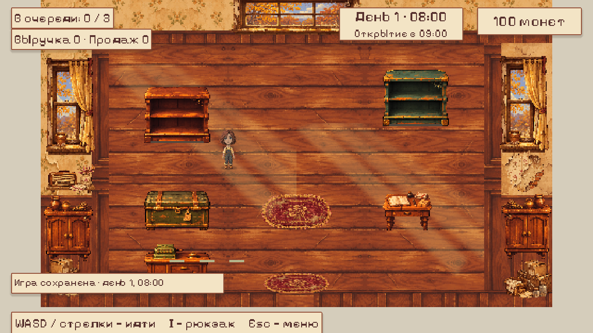
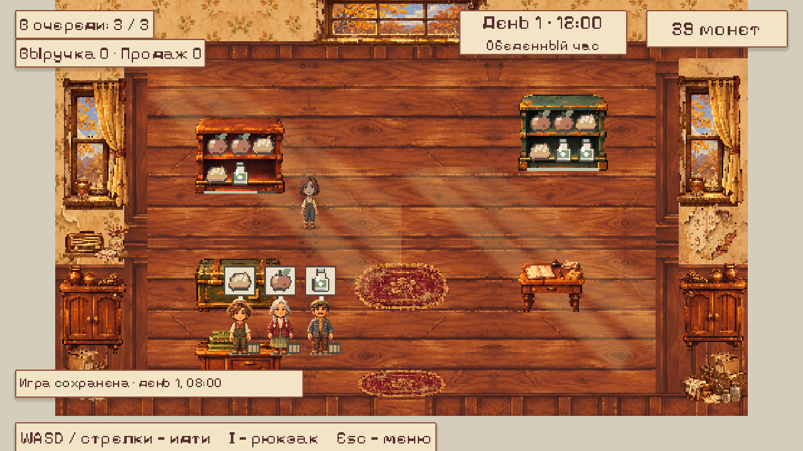
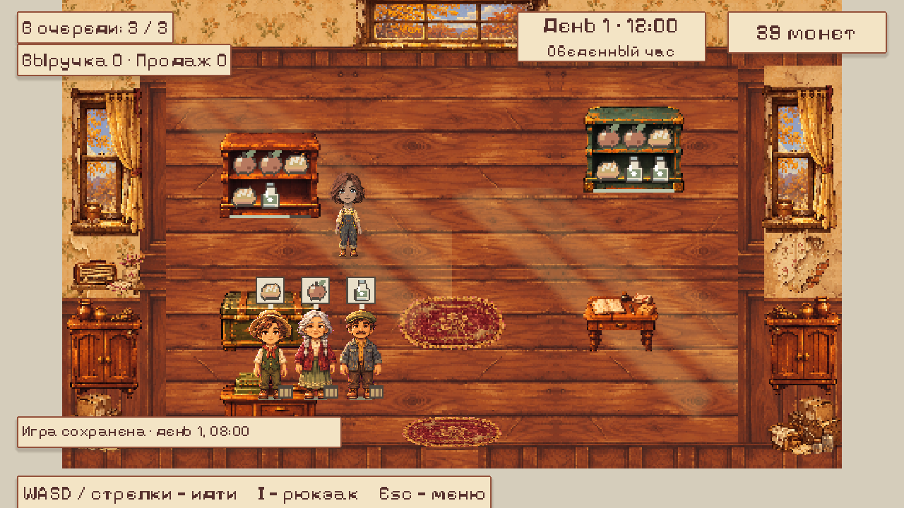
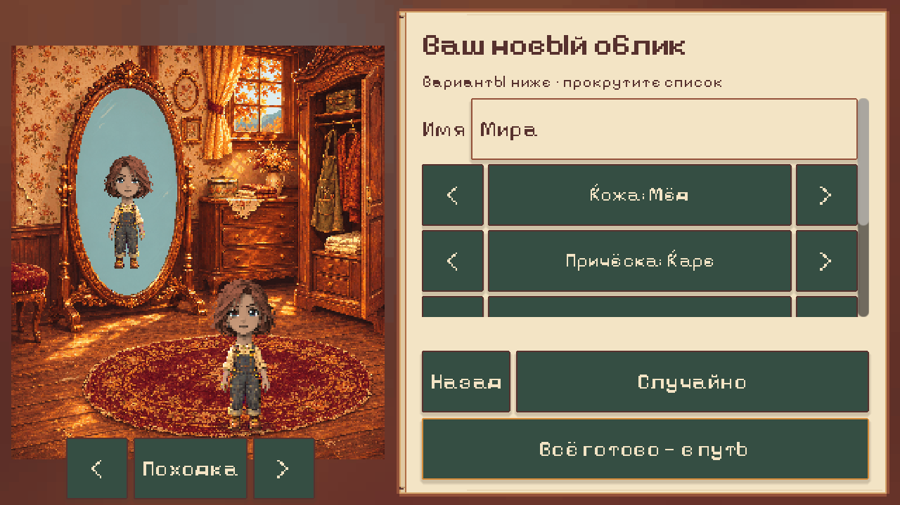
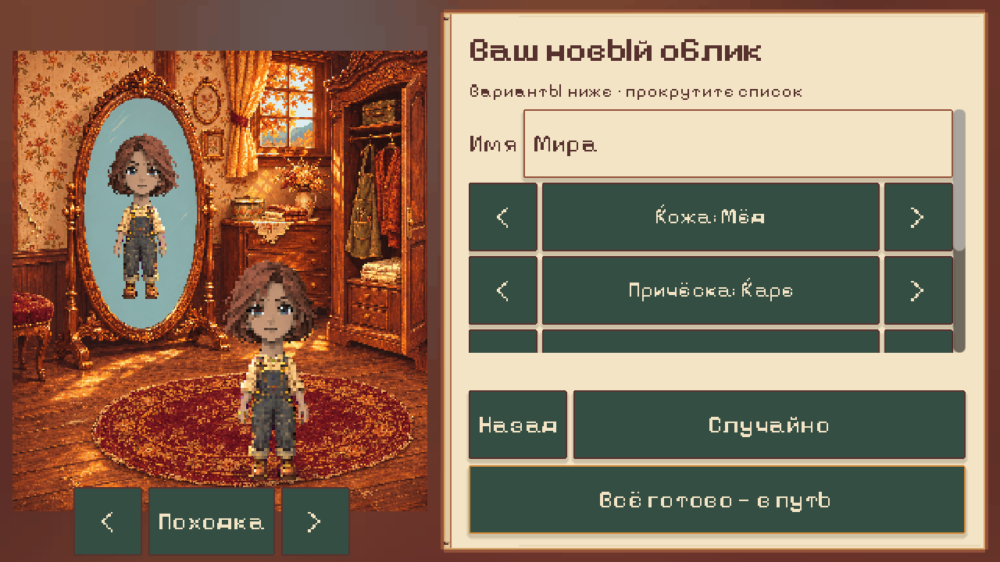
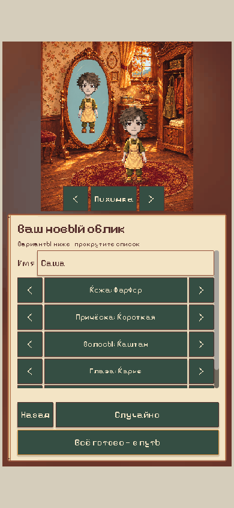
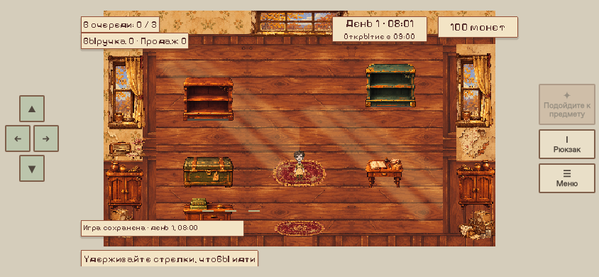
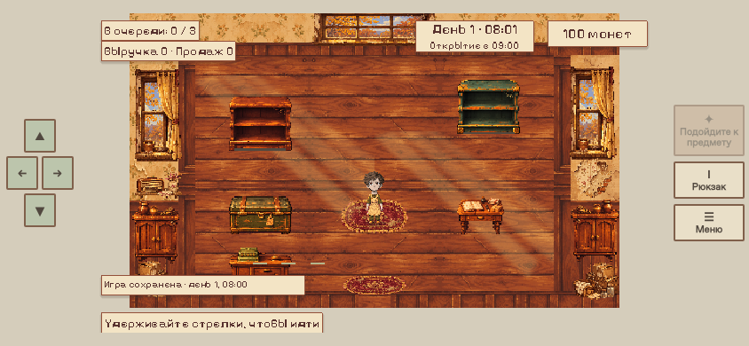

# Корректировка масштаба в PR #17

Исторический этап увеличения спрайтов. Последующая техническая корректировка
камеры: [zoom 1.6 и плавное слежение](camera-review.md). Размеры спрайтов ниже сохранены.

Продолжение `art/illustrated-characters` от `65346fd`, без перехода на main.
Используются прежние художественные PNG и атласы, без генерации и перерисовки ресурсов.

- Герой и NPC: 28×42 → **40×60**, увеличение на **42,9%** с сохранением пропорций.
  Точка рисунка −14,−32 → −20,−50 сохраняет нижнюю опору на y=10. Анимации,
  коллизии, скорости, маршруты и шаг очереди 28 пикселей не меняются.
- Значки товаров: 16×16 → **13×13**, уменьшение на **18,75%**. Рамка тоже меньше,
  объявление перенесено выше увеличенной головы.
- Гардеробная: герой и отражение увеличены на **30%** относительно исходного
  предпросмотра, заново центрированы с сохранением положения ног. Отражение
  остаётся внутри зеркала, герой — над кнопками поворота на телефоне.
- Камера остаётся **1.15**, её положение и интерфейс без изменений: увеличенных
  фигур достаточно для чтения внешности, обзор проходов и входа сохраняется.

Порядок отрисовки актёров над мебелью сохранён. Проверены подход к полке и столу,
проходы, очередь и реальная продажа. Тест по альфа-контурам всех кадров NPC
проверяет, что силуэты помещаются в прежние 28 пикселей между покупателями;
отдельно проверена неизменная опора стоп. Пиксельные наблюдатели веб-тестов
адаптированы к новому размеру без изменения игровых проверок.

## Реальные сравнительные кадры

PNG не редактировались. ПК: настоящий Godot 4.3/OpenGL, одинаковая фикстура,
Мира (кожа 2, каре 1, волосы 5, глаза 2, комбинезон 2), положение героя
(256,173), камера (320,180)/1.15, три обычных посещения покупателей с seed 8.
Для сопоставимости поз анимации на этих кадрах отключены штатной настройкой;
ходьба и дыхание проверены также с включённой анимацией. Временный слот съёмки
очищен после работы. Мобильные кадры — настоящий WebKit-экспорт, новая игра
с тем же стандартным героем, обычные нажатия и поворот viewport.

| Сцена | До (`65346fd`) | После |
| --- | --- | --- |
| Герой у полки |  |  |
| Очередь |  |  |
| Гардеробная |  |  |
| Мобильный редактор |  |  |
| Мобильный магазин |  |  |

Физический iPhone недоступен. WebKit/Chromium проверяют экспорт и сенсорное
управление, но системная клавиатура, панели Safari и аппаратная производительность
настоящего iPhone полностью не эмулируются. Код iOS viewport и кеширования не менялся.

Проверено: **1156 Godot-проверок, 0 failures**; полный `npm test` в Chromium/WebKit,
включая внешний вид после Continue, поезд, cache-upgrade и iOS keyboard/viewport.
Дополнительный Chromium `--gameplay` прошёл закупку, выкладку, продажу, ручное
сохранение и Continue с балансом 102. Web release Godot 4.3 экспортируется
штатным путём; ресурсы персонажей, комнаты, поезда, коллизии и камера не менялись.
