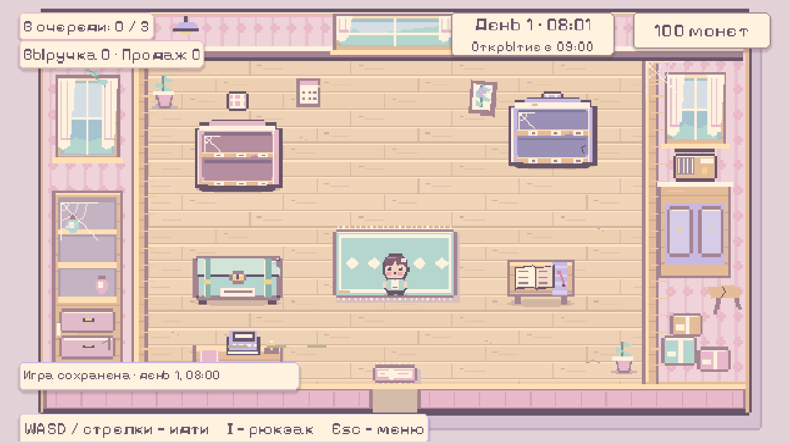
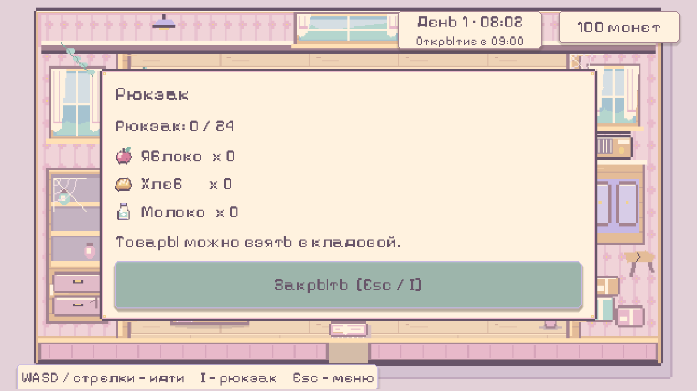
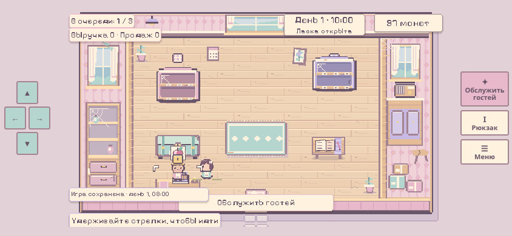
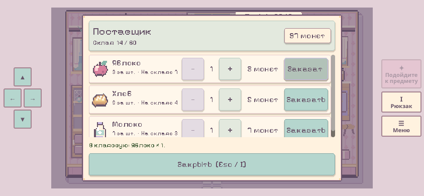
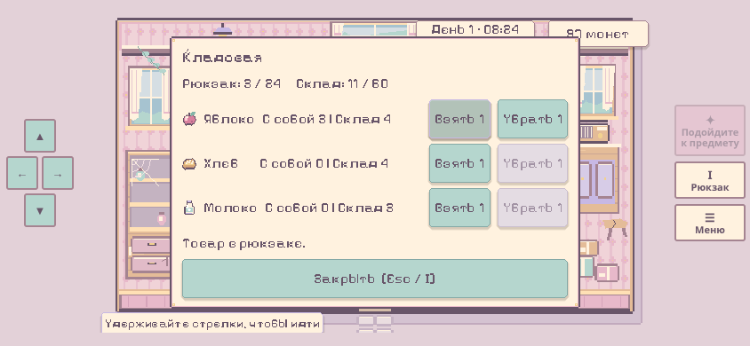
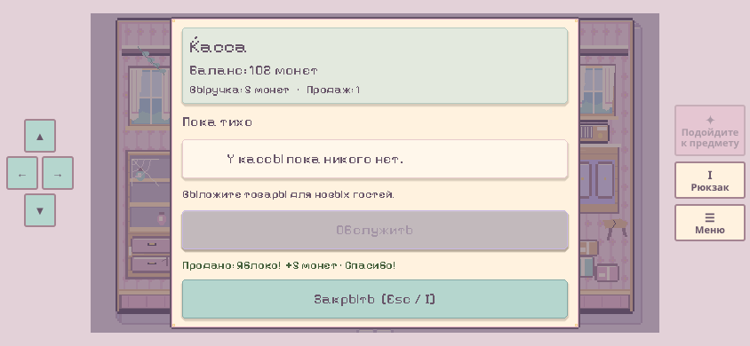

# Пастельная ретро-лавка

Основа: `web-iphone-safari`, коммит `a4550f07f698fddfc4eefe13c33a984bcb442856`.
Изменения находятся в отдельной ветке `feat/pastel-retro-shop`.

## Что изменилось

Вместо тёмного магазина посреди зелёного поля — компактный интерьер почти на весь
экран. Палитра: `#FFF2DF`, `#E8B9CA`, `#C7B8E4`, `#B5D6CE`, `#F2D18F`.
Светлое дерево, старые цветочные обои, занавески, потёртый сервант, ретро-радио,
посылки, пустые витрины, немного паутины и сломанный табурет создают ощущение
уютного магазина, которому ещё предстоит восстановление. Ремонт как механика
на этом этапе не добавлен.

Оригинальные спрайты включают мебель, товары, декор и четыре чиби-персонажа с 48
кадрами. Розовая и сиреневая витрины различаются отделкой, повреждениями и высотой
расположения. Мятный сундук, книга поставщика и сиреневая касса имеют разные силуэты.
Доступный предмет отмечен светлыми пиксельными уголками и значком действия.

Все игровые подписи, товары, меню, подсказки и сообщения переведены на русский.
Пиксельный шрифт с полной кириллицей включён в проект вместе с OFL-лицензией.
День, время и монеты собраны в компактные кремовые карточки. Модальные панели
получили декоративную рамку; товарные строки и кнопки — пастельные цвета.

На телефоне стрелки уменьшены с 44×48 до 36×38 CSS-пикселей; кнопки рюкзака и меню
имеют высоту 42. Контекстная кнопка высотой 58 показывает **«Открыть кладовую»**,
**«Заказать товары»**, **«Выложить товары»** или **«Обслужить гостей»**. Вне радиуса
действия и внутри меню она отключена. Кнопки меню внутри игрового canvas сохраняют
минимум 44×44 для нажатия пальцем. Удержание, диагональное движение, освобождение
указателей при потере фокуса, safe-area и поворот экрана сохранены.

Клавиатура: WASD/стрелки, E, I, Esc. На мобильном экране подсказка описывает
сенсорное управление, на ПК — клавиатуру.

## Что сохранено

Экономика, цены, вместимость, переносы, посетители, касса, время, отчёты и формат
сохранений не менялись. Правая витрина сдвинута на 16 пикселей вверх; покупатели
используют подход из её текущего положения, что проверено тестами маршрутов.
Существующие ключи `LeftShelf` и `RightShelf`, хранилище и IndexedDB-слот прежние.
Декор боковых стен не вводит новых коллизий или действий. Сюжет, создание персонажа,
фермерство и деревня не добавлены.

Веб-экспорт остаётся однопоточным Godot 4.3 Compatibility/WebGL 2. Сохранена
настройка presentation buffer, необходимая существующей ветке для WebKit.

## Проверка

Проверено 24 ноября 2026 года на официальном **Godot 4.3.stable.77dcf97d8**:

- `bash tests/run_checks.sh` — **545 проверок, 0 ошибок**, импорт редактора и запуск
  стартовой сцены. 529 прежних проверок сохранены; текстовые ожидания обновлены
  на русский. 16 новых проверяют покрытие кириллицы, отсутствие наложения HUD,
  размеры всех меню и контекстные подсказки.
- `godot --headless --path . --export-release Web builds/web/index.html` — настоящий
  release export, `.wasm` и `.pck` созданы, ошибок движка или скриптов нет.
- Playwright **1.62.1**, Chromium и Linux WebKit: экранные кнопки, меню, сохранение
  в IndexedDB, перезагрузка, «Продолжить», проверки границ canvas/кнопок при
  **844×390**, **390×844**, **667×375**, **844×300**.
- Полный браузерный сценарий: закупка яблока **100 → 97**, перенос трёх яблок
  в рюкзак, выкладка одного, приход покупателя, продажа за 5 монет **97 → 102**,
  ручное сохранение и восстановление с двумя яблоками в рюкзаке. Используются
  настоящие нажатия и данные IndexedDB; отладочных игровых API нет.

Linux WebKit и мобильная эмуляция не заменяют проверку на физическом iPhone.
На устройстве iOS Safari в этой среде не запускался.

## Реальные скриншоты

Изображения сняты Playwright с работающего веб-релиза, без дорисовки и монтажа.
ПК — 1280×720; мобильный режим — 844×390, touch, DPR 3, сохранение в CSS-размере.
Скриншоты мобильного цикла показывают реальные изменения инвентаря и баланса.








Для воспроизведения: импортировать проект, установить шаблоны экспорта Godot 4.3,
выполнить веб-экспорт и запустить сервер на порту 8060. Затем:

```sh
cd web
npm ci
npx playwright install --with-deps chromium webkit
npm test
npm run test:gameplay
npm run capture:review
```

`GAME_URL` переопределяет URL сервера, `BROWSERS=chromium` выбирает один движок.
`capture:review` выполняет полный Chromium-сценарий и создаёт свежую ПК-сессию;
пересоздаёт `docs/pastel-*.png`. Ошибки сценария сохраняют отдельный кадр в
`builds`, а не заменяют финальные скриншоты. Исходники графики и лицензии:
[assets/README.md](../assets/README.md).
