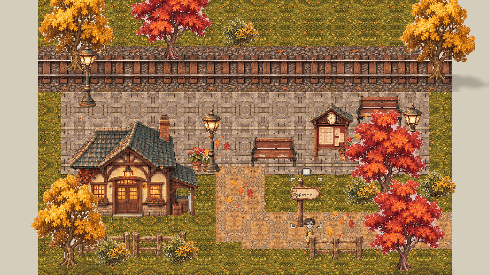

# Тихая станция — первая наружная локация

Ветка `feat/autumn-station` от актуальной `main` **d0bc2e4**.
Прочитан [GAME_DESIGN.md](GAME_DESIGN.md), разделы 1–2 и границы этапа 9;
художественные ориентиры — утверждённые поезд, магазин и персонажи.
Деревня, жители, свинка и новые торговые механики в этот этап не входят.

## Игра

После обычного завершения или подтверждённого пропуска поездки герой оказывается
на пустой платформе. Прежнее затемнение поезда переходит в раскрытие станции;
управление доступно через 0,8 с. Четыре секунды вагон стоит рядом, затем за шесть
секунд уходит направо. Звук колёс затихает; остаются тихий ветер и редкие птицы.
Никто не встречает героя. Три коротких мысли показываются во время свободного
движения и подводят к цели «Найти купленную лавку».

Станция занимает **720×480** игровых единиц. Игровая камера — прежний
`FollowCamera`, **zoom 1.6**, без изменения размеров героя. Доступны платформа,
двор перед зданием и дорожка направо. На пути и через здание пройти нельзя;
основания скамеек, горшков, фонарей, деревьев и ограды имеют отдельные коллизии.
Герой и предметы сортируются по точке опоры на земле, тени лежат отдельным слоем.

Необязательные E/сенсорные действия: расписание с часами, закрытая дверь вокзала,
указатель в деревню. Рюкзак и пауза используют прежние I/Esc и сенсорные кнопки.
Короткие панели и HUD находятся в CanvasLayer и не увеличиваются с миром.
Скрытые предметы магазина исключены из поиска взаимодействий.

Выход по дорожке справа ведёт через затемнение в существующий магазин. Это
временная связь до реализации деревенской улицы. Удерживаемый ввод отпускается
на границе сцен; героя не должно уносить в новой локации.

## Реальные кадры

PNG сняты из работающего Godot 4.3/OpenGL и Web release; без композитинга,
дорисовки или изменения размера скриншотов. Общий план — инструментальный
обзор всей карты с zoom 0.75; в самой игре приближение всегда **1.6**.

- [Общий вид станции](station-overview.png).
- [Герой прибывает на платформу рядом с вагоном](station-arrival.png).
- [Исследование платформы](station-platform.png).
- [Дорожка и указатель в сторону деревни](station-village-path.png).
- [Мобильный WebKit: альбомная ориентация](station-web-mobile-landscape.png).
- [Мобильный WebKit: портретная ориентация](station-web-mobile-portrait.png).
- [Рюкзак в портретной ориентации](station-web-portrait-bag.png).
- [Чтение расписания](station-web-schedule.png).
- [Временный переход в магазин](station-web-temporary-shop.png).



## Оригинальные ресурсы и стоимость

Один оригинальный атлас создан генерацией изображений для этого проекта:
`art/station/outdoor-atlas.png`. Насыщенные янтарные и красные кроны, ореховое
дерево, кремовая штукатурка, тёмная черепица и зелёно-кремовый вагон продолжают
палитру поезда. Перспектива игровых объектов — сверху в три четверти.
Исходник содержит отдельные предметы, а не готовую неподвижную локацию.

`tools/prepare_station_art.py` выполняет импорт: нарезка, очистка альфа-краёв,
nearest-масштаб и палитра 128 цветов. Получаются 16 независимых модулей в
`assets/outdoors/`: деревья двух видов, куст, фонарь, ограда, скамейка, горшки,
указатель, расписание/часы, вокзал, вагон, листья, трава, дорожка, рельсы и платформа.
Они пригодны для новых локаций. `OutdoorProp` объединяет текстуру, точку сортировки,
настраиваемое основание коллизии, необязательную тень и слабое покачивание.

Все новые текстуры окружения вместе — около **0,8 MiB RGBA**. Художественный
мастер исключён из импорта/экспорта существующим `art/.gdignore`. Мягкие тени
деревьев подготовлены заранее. В кадре двигаются только десять маленьких листьев,
несколько готовых спрайтов растительности и один вагон; новых шейдеров, света в
реальном времени, генерации деревьев или физических симуляций нет.

Тихий восьмисекундный WAV ветра/птиц синтезирован офлайн тем же инструментом.
Колёса используют прежний WAV поезда. Всё воспроизводится через существующую
Master-шину и её сохранённую громкость. При отключении анимаций нет падающих
листьев и покачивания; вагон без перемещения мягко исчезает в те же сроки.
Функциональные переходы и управление остаются доступны.

## Переходы и сохранения

`LocationTransition` управляет затемнением и картой логических выходов.
`LocationState.LOCATIONS` хранит путь сцены, стартовую точку и допустимые границы.
Наружная сцена получает `appearance`, `state`, `bag`, `checkpoint` и испускает
`travel_requested(destination)`. Чтобы подставить улицу, нужно зарегистрировать
её сцену/границы/точку входа и поменять соответствие `village` в `DESTINATIONS`;
сам выход станции, механизм затемнения и валидация списка локаций переиспользуются.

Существующий магазин остаётся выключенной моделью торгового состояния на время
прогулки: часы, NPC и экономика не работают, его графика и HUD скрыты.
Формат **v4** добавляет `journey`: ID локации, позицию, время прибытия 0–10 с и
номер мысли 0–3. Завершение поезда атомарно записывает станцию **до** затемнения.
На станции изменённое состояние сохраняется раз в секунду, при уходе приложения
в фон и через меню. Положение после аварийного завершения может отставать до секунды.
Отправившийся вагон и уже завершённые мысли не начинаются заново при Continue.

Назначение выхода записывается до удаления станции. При ошибке записи старая
локация остаётся доступной, управление возвращается, сообщение предлагает повторить
переход. Существующие `.tmp`/проверка чтением/резервная копия/атомарная замена сохранены.

Сохранения **v1/v2/v3** поддерживаются. Завершённые старые игры продолжаются в
магазине, без повторной поездки и принудительного посещения станции. Незавершённый
поезд v3 сохраняет свой checkpoint. Миграция в памяти не переписывает исходный файл
до следующего успешного сохранения. Неподдерживаемые версии и неверные координаты,
этапы или несовместимые story/location отклоняются до изменения состояния.

Графика и тексты истории поезда, внешность/анимации героя, интерьер и торговля
не изменены. В UI поезда поправлены только названия назначения: «На платформу» и
подсказка пропуска. HTML-оболочка, iOS keyboard/viewport, настройки масштабирования,
экспортные кеш-ключи и `package_release.py` не менялись.

## Проверка и воспроизведение

```sh
GODOT_BIN=/path/to/godot-4.3 bash tests/run_checks.sh
# На графическом дисплее, без открытия игрового save-слота:
godot --path . --audio-driver Dummy --fixed-fps 60 --script res://tools/capture_station.gd
mkdir -p builds/web
godot --headless --path . --export-release Web builds/web/index.html
python3 tools/package_release.py builds/web "$(git rev-parse HEAD)" --ref refs/heads/feat/autumn-station
python3 -m http.server 8060 --bind 127.0.0.1 --directory builds/web
# Другой терминал:
cd web
npm ci
npm test
BROWSERS=chromium node smoke.cjs --gameplay
BROWSERS=webkit npm run capture:station
```

Godot: **4829 проверок, 0 failures**, из них **905** — станция. Проверены настоящая
ходьба по проходам, камера и границы, коллизии здания и путей, все три осмотра,
модальный ввод, отсутствие скрытых объектов, отправление, уменьшение анимаций,
громкость, замороженная экономика, позиция/облик/Continue, миграции v1–v3,
неверные снимки, отказ автосохранения и отказ записи на выходе, повтор перехода.

Полный `BROWSERS=webkit npm test` прошёл: прежний smoke/торговый интерфейс,
редактор и сохранение внешности, полная поездка с возобновлением, новая станция,
обновление кешированной версии и iOS keyboard/viewport/rotation. Сценарий станции
проверяет перезапуск до/после отправления, расписание и указатель, обе ориентации,
рюкзак, позицию, переход и Continue в магазине. Финальная съёмка повторила этот
сценарий с окончательной подсветкой предметов.

Chromium `--gameplay` прошёл через поезд и станцию: настоящие закупка, склад,
выкладка, обслуживание покупателя, ручное сохранение и Continue; ожидаемый баланс
**102**, два яблока в рюкзаке. Наблюдатель станции читает только сохранение и
управляет обычными сенсорными кнопками; игровых debug-хуков нет. Он дожидается
асинхронного обновления IndexedDB перед следующим шагом и на границе перехода.

Web release Godot 4.3 экспортирован без ошибок скриптов/импорта; SHA-256 всех
файлов проверены по манифесту. В отдельных headless-тестах при завершении Godot
выводит предупреждение ObjectDB; verbose-прогон станции указывает на WAV/playback
при выключении аудиосервера. Ошибок проверок и браузерных сценариев нет.

Физический iPhone недоступен. Chromium/WebKit используют профиль iPhone; GPU,
системная клавиатура и панели аппаратного Safari полностью не эмулируются.
